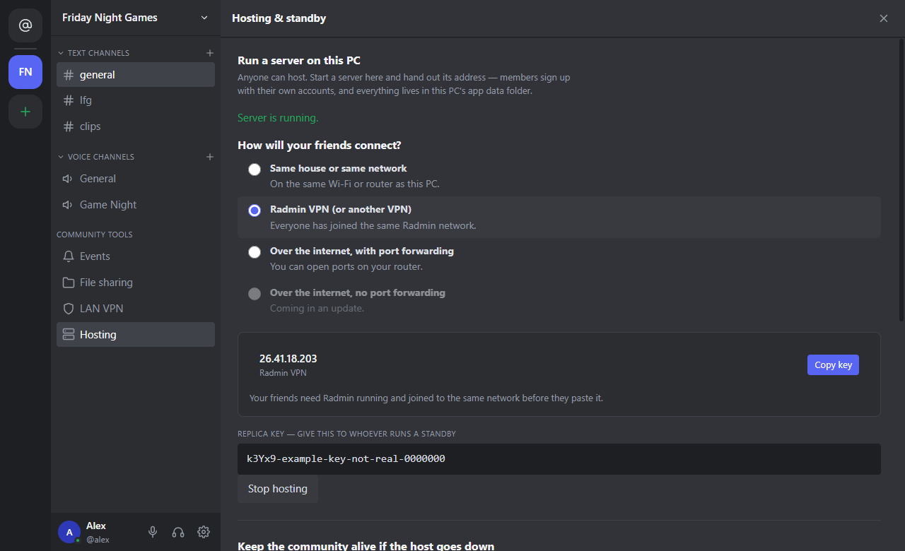

# Hosting a p2pchat community

One person **hosts**: their PC runs the community, and everyone else **joins** it with a connect key. Pick the
section that matches where your friends are.

> Hosting runs a server on your PC that other people connect to. p2pchat is provided as is and you use it at your
> own risk: see [Use at your own risk](README.md#use-at-your-own-risk).

When you host, the app asks the same question and gives you the right key:

<p align="center"></p>

| Where your friends are | What you need | Status |
|---|---|---|
| [Same house or same network](#1-same-house-or-same-network) | Nothing | Works now |
| [On your own VPN](#2-on-your-own-vpn) (like Radmin VPN, ZeroTier or Tailscale) | Everyone on the same VPN network | Works now |
| [Anywhere, with port forwarding](#3-anywhere-with-port-forwarding) | Three ports forwarded on the host's router | Works now |
| [Anywhere, no port forwarding](#4-anywhere-no-port-forwarding) | Your own small Linux VPS as the meeting point | App side in the next update |

## Before you start (everyone)
1. Download `p2pchat-…-setup.exe` from the [latest release](https://github.com/riaanclaw/p2pchat-releases/releases/latest).
2. Run it. Windows may say **"Windows protected your PC"**, because this test build is not signed yet.
   Click **More info → Run anyway**.
3. The first time someone joins a community's LAN, Windows asks once for administrator permission
   to set up the network adapter.

## 1. Same house or same network
1. **Host:** open p2pchat and choose **Host a community**. Create your account with the owner key it shows you.
2. The app shows a **connect key** for your network address. Send it to your friends.
3. **Friends:** open p2pchat, choose **Join**, and paste the connect key.

## 2. On your own VPN
If your group already shares a VPN, like **Radmin VPN**, **ZeroTier** or **Tailscale**:
1. Everyone installs it and joins the same network.
2. The host picks **Your own VPN** under *How will your friends connect?* and copies the key it shows.
3. Friends paste the key, as in section 1.

## 3. Anywhere, with port forwarding
1. On the host's router, forward these to the host PC:
   - **TCP 8787**: chat, files and sign-in
   - **UDP 8787**: voice and video
   - **UDP 4242**: the community's LAN (4243, 4244 … for any extra communities)
2. Host as in section 1, then send friends a connect key that uses your **public IP address**.
   ([whatismyip.com](https://whatismyip.com) shows it.)

If your internet provider uses carrier-grade NAT (common on fibre), port forwarding can't work. Use section 2, or
section 4.

## 4. Anywhere, no port forwarding
This is how Radmin and Tailscale feel: the host sends a friend an invite, and it just works. It is built on
[Nebula](https://github.com/slackhq/nebula), the open-source overlay network p2pchat already uses for the
community LAN. The p2pchat app side arrives in the next app update; you can set up your meeting point now.

- No home router needs a port opened. Instead, **the host runs a small meeting point on their own public
  server** (any Linux VPS). There is no shared one: yours serves only your communities.
- The host's PC and every friend dial **out** to it. It introduces them, and they connect **directly**.
- If two routers are too strict for a direct line, the meeting point **relays** their traffic, still
  encrypted, so it can never read it.
- Everyone who joins is on the community's private Nebula network. The app asks friends to agree to that
  first, and keeps their PC closed except for ports they open for a game they host.

### Set up your meeting point (one command)
On a Linux VPS (x86_64 or arm64, Debian or Ubuntu), as root:

```bash
curl -fsSL https://github.com/riaanclaw/p2pchat-releases/raw/main/install-meet.sh | sudo bash
```

It installs the meeting point and Nebula (both checksum-pinned), opens **TCP 7380** and **UDP 4243–4342** in
ufw or firewalld, starts it as a service, and prints two things to paste into p2pchat:

- the **meeting point address**, like `http://203.0.113.7:7380`
- its **registration key**: only hosts with it can use your meeting point. Keep it to yourself.

If your VPS provider has its own firewall (AWS, Oracle Cloud, Hetzner or DigitalOcean cloud firewalls), open
the same ports there too.

Then in p2pchat, on the hosting PC: **Hosting → How will your friends connect? → Over the internet, no port
forwarding**, paste the address and key, **Turn on**, and send friends the "No port forwarding" key from an
invite (Community settings → Invites → Send to friends).

Other options, after `| sudo bash -s --`:

- `--open`: a public box anyone can register on (instead of only hosts with the key).
- `--relay-only`: a dedicated relay box that only carries traffic for communities.
- `--uninstall`: removes it again (community keys stay in `/var/lib/p2pchat-meet` until you delete them).
- Run the same command again to upgrade. Every community and the key are kept.

How much it carries: traffic goes direct after the two PCs find each other; the meeting point relays only
for pairs that cannot. For each relayed pair, roughly 50–100 kbit/s per person talking and 1–4 Mbit/s per
screen share, plus game traffic. A VPS with about 100 Mbit/s covers a handful of relayed pairs at once.

## Questions
- **Is my chat private?** Direct messages are end-to-end encrypted. The community's LAN traffic is encrypted
  between machines.
- **Does the meeting point see my files?** No. Files go directly between members. Only when a direct line is
  impossible does traffic pass through it, and then still encrypted.
