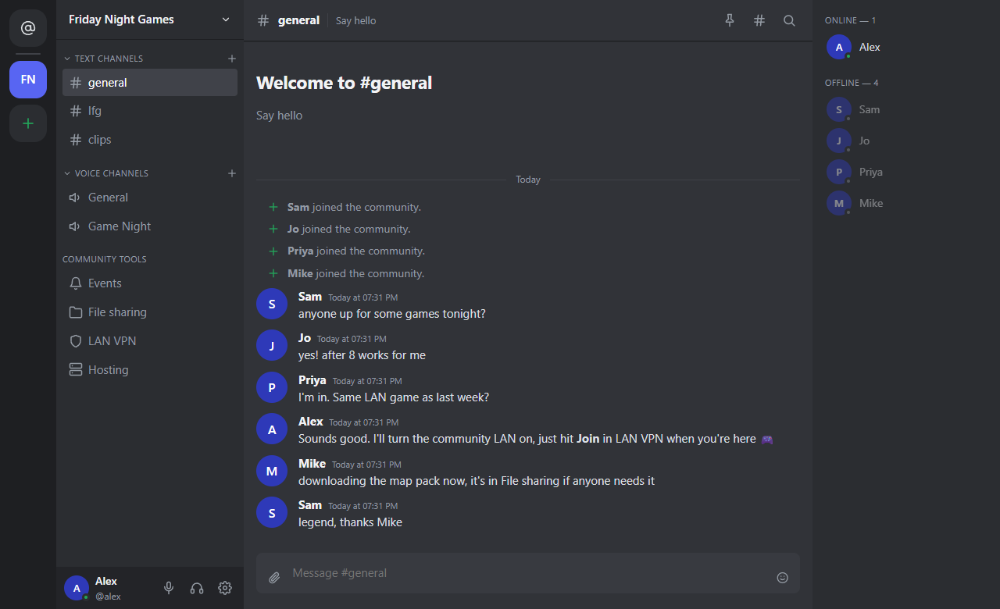
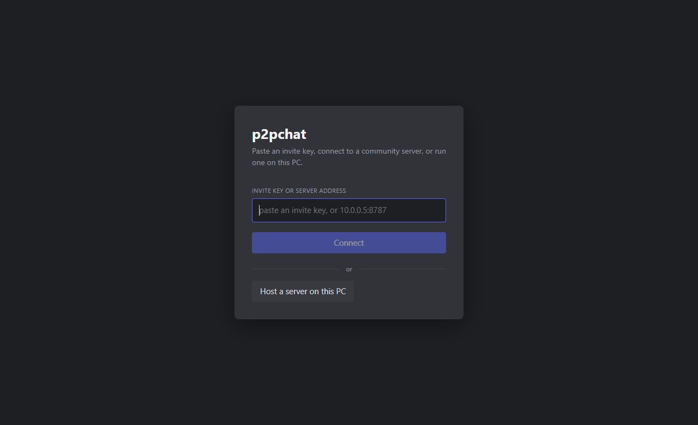
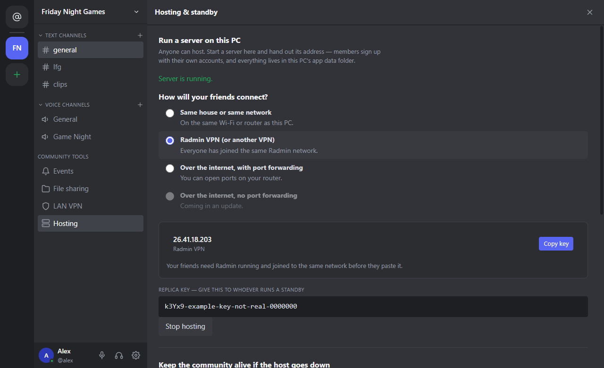
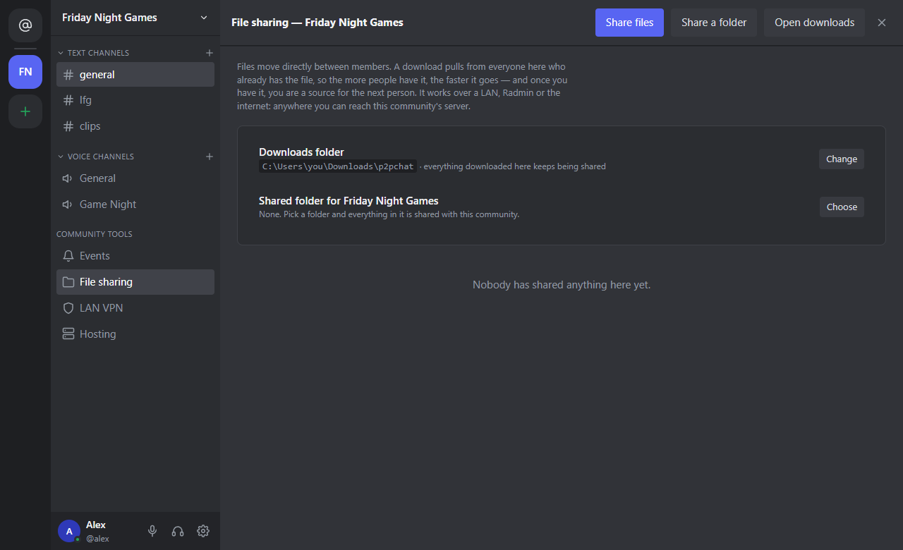
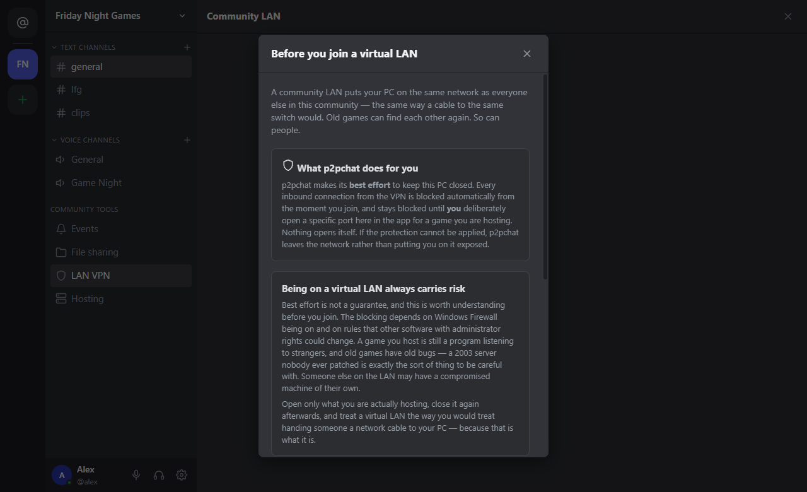

<h1 align="center">p2pchat</h1>

  <b>Think of it like Discord, except you own your data.</b> 
  Chat, voice, file sharing and a private LAN for your gaming group, hosted on your own PC. 
  No company in the middle, no subscription, nothing to rent.

  <a href="https://github.com/riaanclaw/p2pchat-releases/releases/latest"><b>⬇ Download for Windows</b></a>
  &nbsp;·&nbsp;
  <a href="HOSTING.md">Hosting guide</a>
  &nbsp;·&nbsp;
  <a href="#use-at-your-own-risk">Use at your own risk</a>

> **Test builds.** p2pchat is early. Things will change, and some will break. Updates arrive inside the app.

## Like Discord, but yours

If you've used Discord, you already know your way around: communities, text channels, voice rooms, roles and
invites. The difference is **where it lives**. With p2pchat:

- **Your community runs on your PC**, or a friend's. Messages, files and member lists stay on hardware you control.
- **No account with a company.** Accounts belong to your community's server, not to a platform.
- **Nobody can shut your community down, change the rules or sell your data.** It's yours.
- **Leaving is easy.** Your data is files in a folder on your PC. Copy them, back them up, or delete them.

## What it does

- **Text and voice channels.** Chat, mentions, pins, threads and voice or video rooms.
- **File sharing between members.** Files go straight from member to member, never through a server. The more
  people have a file, the faster the next download.
- **A private LAN for old games.** Turn on the community LAN and LAN-only games find each other as if you were in
  one room. Built on [Nebula](https://github.com/slackhq/nebula) (see [Built with](#built-with)).
- **You host it.** One click runs the server on your PC. Your messages and files live on your PC, not on someone
  else's cloud.
- **Standby hosts.** A friend can keep a live copy, so the community carries on if your PC goes offline.
- **Updates itself.** When a new version is out, a bar at the top offers it. Nothing installs until you click.

## Getting started

1. **Download** `p2pchat-…-setup.exe` from the [latest release](https://github.com/riaanclaw/p2pchat-releases/releases/latest) and run it.
   Windows may say *"Windows protected your PC"* because the test builds are not code-signed yet: click
   **More info → Run anyway**.
2. **One person hosts.** Open p2pchat and click **Host a server on this PC**, then create your account.
3. **Invite friends.** The app asks *How will your friends connect?* and gives you the key to send.
4. **Friends join.** They install p2pchat, paste the key, and make their own account.

  
  

### How will your friends connect?

| Where your friends are | What you need | Status |
|---|---|---|
| Same house or same network | Nothing | ✅ Works now |
| On your own VPN, like [Radmin VPN](https://www.radmin-vpn.com/), [ZeroTier](https://www.zerotier.com/) or [Tailscale](https://tailscale.com/) | Everyone on the same VPN network | ✅ Works now |
| Anywhere, with port forwarding | Three ports opened on the host's router | ✅ Works now |
| Anywhere, **no port forwarding** | Your own small VPS as the meeting point ([one command](HOSTING.md#set-up-your-meeting-point-one-command)) | 🛠 App side in the next update |

Step-by-step instructions for each are in the **[hosting guide](HOSTING.md)**.

  
  

## Privacy and safety

- **Your community lives on the host's PC.** There is no p2pchat company server holding your messages.
- **Direct messages are end-to-end encrypted.** Not even the host can read them.
- **Community LAN traffic is encrypted** between members' PCs by Nebula.
- **Joining a LAN shows a plain warning first.** p2pchat blocks incoming connections from the LAN by default, and
  only opens a port when you do it yourself.
- **The no-port-forwarding update** adds a small public *meeting point* that introduces members to each other.
  Traffic goes directly between members when it can. When two routers are too strict for that, the meeting point
  relays it, still encrypted, so it can never read it. Each host runs their own, with [one command](HOSTING.md#set-up-your-meeting-point-one-command).

## Use at your own risk

p2pchat is free software provided **"as is", without warranty of any kind**. You use it, host it and connect it to
other people's PCs **at your own risk**. The authors are not liable for any damage, data loss, security
incident or other harm that comes from using it. See the [MIT License](LICENSE).

In particular:
- Only join communities and LANs run by **people you trust**. A virtual LAN puts your PC on the same network as
  everyone else on it.
- **Hosting** means your PC runs a server that other people connect to. Keep Windows and p2pchat up to date.
- These are **test builds**. Keep your own copy of anything that matters.

## Built with

p2pchat stands on these open-source projects, bundled in the installer under their own licences:

- **[Nebula](https://github.com/slackhq/nebula)** by Slack Technologies and Defined Networking (MIT): the
  encrypted overlay network behind the community LAN and, soon, joining without port forwarding.
- **[Wintun](https://www.wintun.net/)** by WireGuard LLC: the Windows network adapter Nebula uses.
- **[Electron](https://www.electronjs.org/)** (MIT), **[React](https://react.dev/)** (MIT) and others listed in
  [NOTICE.md](NOTICE.md).

## Updates

The app checks this repository's latest release when it starts and offers newer versions. A download is checked
against the SHA-512 in the release before it installs. Release notes are on the
[releases page](https://github.com/riaanclaw/p2pchat-releases/releases).

This repository holds only the published builds and guides. Found a problem? Open an
[issue](https://github.com/riaanclaw/p2pchat-releases/issues).
